# Pac-Man (Apple II, Atari 1983): a documented reconstruction and a native Windows port

> **Disclosure:** I am not a programmer. This entire project - the analysis of the original game, the C++ code, the tests and the documentation - was done with the assistance of Claude, Anthropic's AI model, working in Claude Code. I set the goals, made the decisions and played the results; Claude wrote the code, the tests and the notes.

A non-commercial hobby project with two parts:

1. **A reconstruction of the original program.** The 1983 Atari release of Pac-Man for the Apple II (a DOS 3.3 disk image the owner already has) was taken apart: its code, tables, graphics routines, ghost logic, level data, sound and intermissions were analysed, and every claim in the notes is marked *Verified*, *Inferred* or *Unknown*.
2. **A native Windows 10/11 program that plays that game** without an emulator and without reading the disk image while playing. Its game logic, timing, drawing and sound were rebuilt in C++ and compared tick by tick with a reference model that runs the original program; then it was given the options a modern player expects.

| | |
|---|---|
| 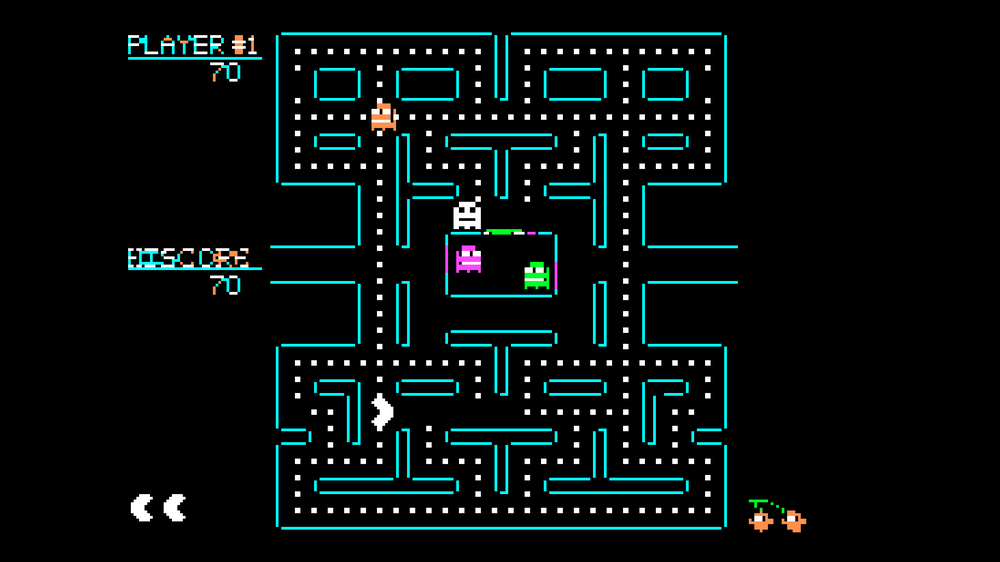 | 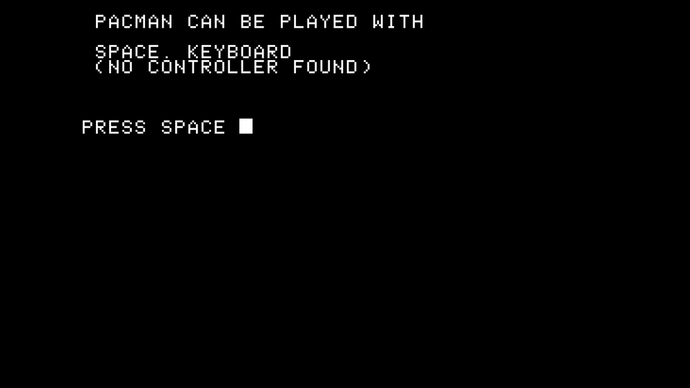 |

**How close is it to the original?** Everything that happens in play, in drawing and in timing equals the original on every scenario recorded: all 29,494 ordinary game ticks of 41 recordings (and 7,918 more with ghosts eaten in a row) take exactly the same number of CPU cycles, the game state of every tick is equal, the drawing calls are equal and the screens match pixel for pixel. A short list of rare moments (being caught, the end of a level, the bonus life, the fruit) is timed from measurements instead of being counted; Xbox controller support is implemented from documentation only and has never been tried on a real controller. The whole story, with the numbers and what is not established, is in [`docs/OVERVIEW.md`](docs/OVERVIEW.md).

## Using it

The release is one zip, `PacMan-AppleII.zip`. Unpack it, put **your own disk image of the game** (a `.dsk` file) in the same folder and start `PacMan.exe`. The first time, the program reads the disk image once, checks that it is the exact original and keeps what it needs in `%LOCALAPPDATA%\PacmanAppleIIPort`; after that the image is not needed. If it cannot find the image it asks for it. Details for players are in [`port/release/README.txt`](port/release/README.txt), which is also in the zip.

## Features

**The game, as the original plays it**
* The whole game: the four ghosts with their modes, timers and speeds per level; dots, energizers, bonus fruit, extra lives, scoring; every level up to the endless ones; the three intermission cartoons; the death animation; GAME OVER and the attract loop with the title, the character parade and the demo game; one to five players taking turns; the hidden menu (rank / cartoon) and the customised-keys menu.
* The Apple II speaker sound, played through a model of the speaker, with the original's timing (the game stands still while a sound plays, as the original does).
* The original's quirks are kept on purpose, including the 38 "forced" bytes of its code that only run in unusual paths ([`docs/FORCED_CODE.md`](docs/FORCED_CODE.md)).

**Modern options** (Esc, or the menu button of a controller)
* Display: borderless full screen or a resizable window, whole-number scaling of the 280 x 192 picture at any resolution, optional window frame.
* Backgrounds: black, an ambient glow, an Apple II monitor with its bezel, or the Apple II desktop.
* Colour: original colour (solid colour for the patterns of every second dot, as a colour display shows them) or green phosphor with the half-dot positions of a monochrome monitor.
* CRT filter: scanlines, softness, transition, glow, colour blend, curvature, afterglow, brightness and contrast, with presets.
* **Controls:** keyboard, Xbox (XInput) controllers (implemented from Microsoft's documentation, not tried on a real one), DualShock 4 and DualSense (USB or Bluetooth) with vibration and, on the DualShock 4 and DualSense, a light bar in the game's own colours (each Off / Low / Medium / High on the Controls page), found automatically, also when plugged in while the program runs. The first menu, the players prompt and the "press return" prompt name the buttons of the controller that is plugged in. A Controls page in the menu lists the controls of each device with their symbols and follows the device in use.
* **Achievements:** the 22 achievements (190 points) of the RetroAchievements set for this game, checked by the program while you play, with pop-ups, a page in the menu and a local save. Nothing is sent anywhere.
* Settings are kept between runs.

| | | |
|---|---|---|
| 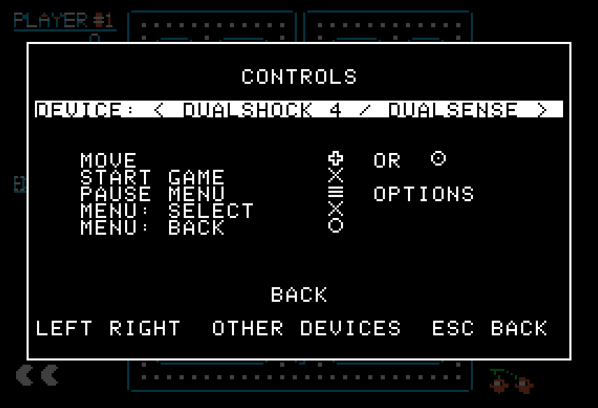 | 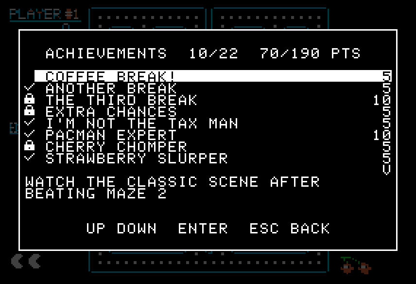 | 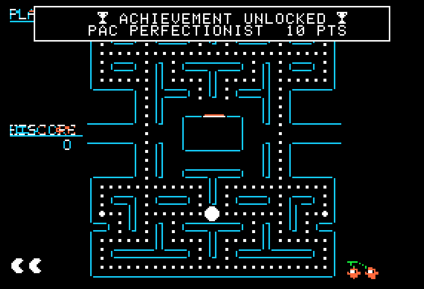 |

## Screenshots
The pictures show the original game's graphics running in the port.

| Original colour | Native Black & White (green phosphor) |
|---|---|
|  | 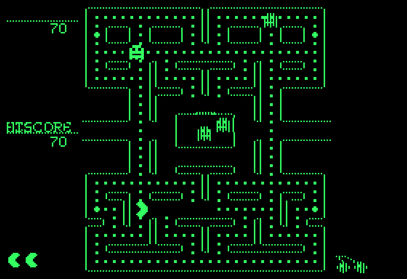 |

| CRT filter (Classic preset) | Apple II monitor background |
|---|---|
| 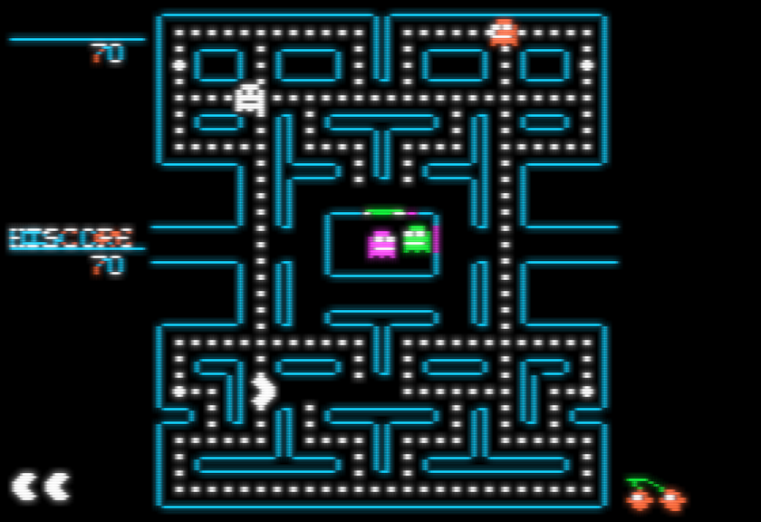 | 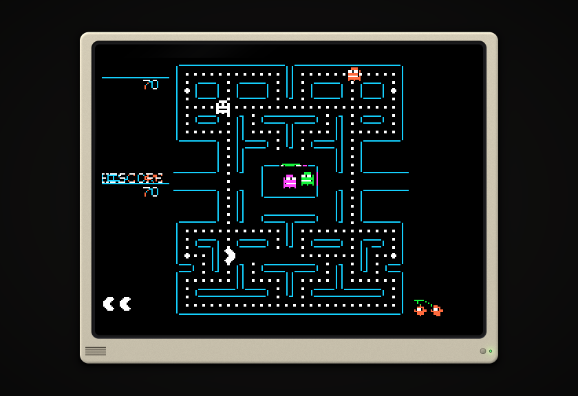 |

| Apple II desktop background | The pause menu (Esc) |
|---|---|
| 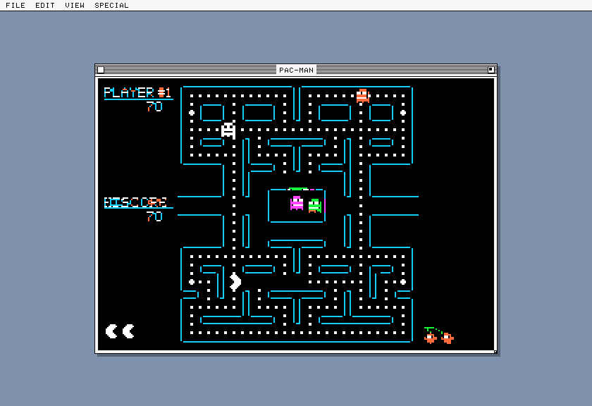 | 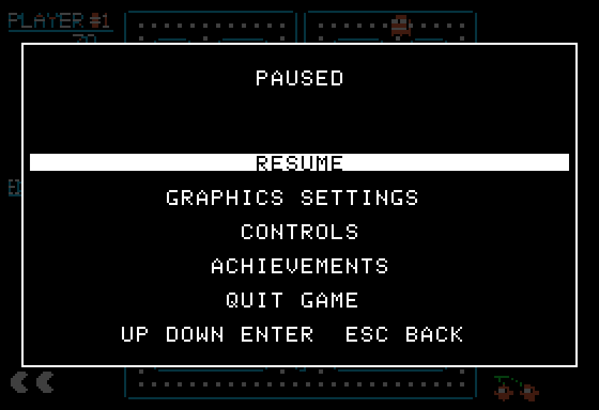 |

| Graphics settings |
|---|
| 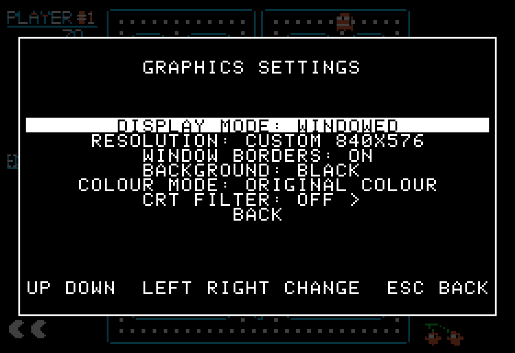 |

## How it was made, and how it is checked

The disk image was analysed with Python tools (a 6502 disassembler, a 6502 core and a model of the Apple II, written for this project and checked against an Apple II emulator). That model, the **oracle**, runs the original program; its behaviour was recorded per tick (state, drawing calls, sound clicks). The C++ port rebuilds each routine and is compared with those recordings: tens of thousands of ticks of free-running play, every drawn page, every sound, the level ends and the intermissions. Where the port could not be compared, the notes say so.

* **Tests:** 287 C++ tests (`port/tests`), many of which need the disk image to compare with the oracle's recordings; Python tests for the tools (`tests`).
* **Notes:** `docs/` holds the findings, the plans and the decisions; start with [`docs/INDEX.md`](docs/INDEX.md). [`docs/KNOWN_ISSUES.md`](docs/KNOWN_ISSUES.md) lists what is open.

## Building

Needs Windows 10/11 and the Visual Studio Build Tools (C++ workload); nothing is downloaded and there are no third-party libraries.

```
port\build.bat          rem the program, the tools and the tests into out\bat
Run-Tests.bat           rem the tests (it uses the disk image next to it for the comparisons)
Play-Game.bat           rem starts the build from out\bat with the local game data
port\release.bat        rem the release zip in out\release
```
`port/CMakeLists.txt` builds the same with CMake. More in [`docs/BUILDING.md`](docs/BUILDING.md).

## Layout

| Folder | Content |
|---|---|
| `port/src/core` | the game: state, input, step timer, eating, ghosts, drawing calls, sound, cartoons, the attract flow and the achievements; no Windows code |
| `port/src/hires`, `port/src/video` | the Apple II hi-res page and its colour / monochrome decoding |
| `port/src/datapack`, `port/src/verify` | the disk image check and the game data pack built from it |
| `port/src/app` | the Windows program: window, Direct3D renderer, pause menu, settings, controllers, audio, achievements |
| `port/tests` | the C++ tests |
| `port/release` | the readme and notices that go into the release |
| `tools/`, `tests/` | the Python development tools (disassembler, oracle, recorders, models) and their tests |
| `docs/` | all notes ([index](docs/INDEX.md)), and `docs/images` for the screenshots |
| `Apple II roms/` | the two ROM files the program needs (see below) |

## What the repository contains, and what it does not

It contains the code, the notes, the tests, the screenshots above (which show the game running) and **two Apple II ROM dumps** (the Autostart Monitor 341-0020 and the character generator 341-0036) that the program needs at run time. It does **not** contain the game's disk image, any bytes extracted from it, or the game's original graphics and sound as files: the program builds its data from the player's own image (`scratch/`, `*.dsk`, `*.pmpk` are ignored by git).The ROM files remain the property of their owner. See [`NOTICES.md`](NOTICES.md).

## Principles

* The original gameplay (logic, timing, collisions, input, animations) must not change; modern options are separate, optional and tested one by one.
* Everything in the result is based on the supplied `.dsk` file.
* Claims are marked Verified / Inferred / Unknown; a test is never weakened to make it pass.

## Licence
The source code and the notes of this project are licensed under the **GNU General Public License v3.0** ([`LICENSE`](LICENSE)). The licence does not cover the game (its disk image, code, graphics and sounds are not part of this repository), the two Apple II ROM files in `Apple II roms/`, or the screenshots, which show the original game's graphics. This is an unofficial fan project, not affiliated with or endorsed by Atari, Namco, Apple or RetroAchievements; see [`NOTICES.md`](NOTICES.md).

